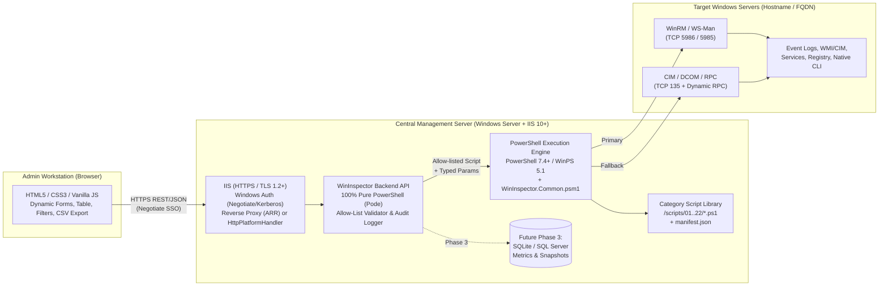

# WinInspector — Project Summary & Architecture Plan

## 1. Executive Summary & Project Vision

**WinInspector** is a centralized, IIS-hosted HTML5 web application for diagnosing and troubleshooting Windows Server operating system, infrastructure, and service issues. Administrators enter a target server hostname or FQDN, connect using either their current Windows credentials or a configured service account, select a troubleshooting category from a structured taxonomy (derived from `TroubleshootingCategories.txt`), and execute vetted PowerShell / native Windows diagnostic scripts remotely over WinRM, CIM/DCOM, or RPC.

### Core Goals
1. **Simple, Dynamic HTML5 Interface**: Clean, zero-build frontend (HTML5, CSS3, Vanilla JS ES Modules) that dynamically generates parameter controls and table columns across **24 categories / 71 sub-categories** (including **Category 2: Management**, **Category 21: Live Performance + Merged Local Terminal**, and **Category 24: Standalone Local Terminal**).
2. **Flexible Remote Connectivity**: Supports Hostname or FQDN targeting with automatic short-name-to-FQDN DNS resolution, protocol discovery, and fallback across **WinRM (WS-Man HTTP/HTTPS)**, **CIM/DCOM (RPC)**, **SMB**, and native Windows remote CLI tools.
3. **Enterprise-Safe Authentication**: Mandatory `/login` gate supporting **UPN Session Authentication** (`user@domain.net` validated via Win32 `LogonUser`, resolved to `DOMAIN\SamAccountName` and stored in an isolated per-session read-only `SecureString` vault), **Local Passthrough** gated behind a salted PBKDF2-SHA256 master password (default `a1b2c3` with first-time reset), and optional HTTPS-protected **Alternate Credentials (Run-As)**.
4. **Actionable Analysis, Process Deep Dive & Local Terminal**: Interactive table output with column sorting, search, multi-facet filtering, click-to-toggle filters (`Process`, `Client IP`, `Local Port`, `Remote Port`), **Process Deep Analysis** modal (CPU, RAM, Private Bytes, GPU/VRAM, Disk I/O rates, open sockets, loaded DLLs) + **Kill Process**, embedded searchable **Local Troubleshooting Terminal** with context-parameter binding, and **CSV Export**.
5. **Modular, Category-Aligned Script Library**: Predictable PowerShell directory layout (`scripts/01..23`) with vetted `Get-*` inspection scripts across all 24 categories.
6. **SQLite-Backed Live Metrics**: Native `winsqlite3.dll` persistence (`data/wininspector.db`) for 1–15s live performance, GPU, adapter packet errors, top processes, and network/SMB/pipe telemetry.

---

## 2. System Architecture

Browsers cannot directly open WinRM, WMI/DCOM, or RPC sockets or execute local PowerShell commands. Hosting WinInspector on a **central Windows management server running IIS** requires a thin, secure server-side API layer that bridges the HTML5 frontend to PowerShell and native Windows diagnostic utilities.



### Backend Technology Decision (100% Pure PowerShell on IIS)

WinInspector uses a **100% pure-PowerShell backend powered by [Pode](https://github.com/Badgerati/Pode)** hosted behind **IIS** on the central management server. No C# compilation or Node.js build chain is required.

| IIS Hosting Mode | How It Works | Best For |
| :--- | :--- | :--- |
| **IIS + `HttpPlatformHandler`** | IIS manages the Pode `pwsh.exe` process lifecycle via `web.config` and terminates HTTPS, while Pode enforces mandatory `/login` UPN session authentication and per-session `SecureString` credential injection. | Environments hosting WinInspector behind IIS without a separate service wrapper. |
| **IIS Reverse Proxy (`ARR` + `URL Rewrite`) + Windows Service (`SYSTEM` / Local Account)** | Pode runs on `127.0.0.1:8085` as `NT AUTHORITY\SYSTEM` or a local service account; IIS terminates HTTPS and proxies requests while Pode enforces `/login` UPN auth and isolated per-session credential injection. | Production environments running Pode as a dedicated Windows Service behind HTTPS. |
| **Local Dev Mode (`-DevMode`)** | Runs `pwsh -File server\Start-WinInspector.ps1 -DevMode` directly on `http://127.0.0.1:8085` with forced `/login` authentication enabled. | Rapid local testing & standalone localhost administrative console. |

> **Design Principle**: The HTML5 frontend communicates solely with a clean REST/JSON API (`/api/health`, `/api/catalog`, `/api/connect/test`, `/api/diagnostics/run`), keeping UI and PowerShell backend cleanly separated.

---

## 3. Remote Connectivity, Protocols & Authentication

### 3.1 Remote Protocol Strategy & Fallback Order

WinInspector targets remote servers by **NetBIOS hostname** or **FQDN** (preferred for Kerberos SPN matching) and automatically negotiates the best available protocol:

1. **WinRM over HTTPS (`TCP 5986`)** — Preferred for `Invoke-Command`, remote script blocks, and `New-CimSession` (WS-Man).
2. **WinRM over HTTP (`TCP 5985`)** — Standard domain-joined WinRM (payload encrypted via Kerberos/Negotiate).
3. **CIM over DCOM / RPC (`TCP 135` + Ephemeral `49152–65535`)** — Automatic fallback for servers where WinRM is disabled or blocked. Supports `New-CimSessionOption -Protocol Dcom`, `Get-WinEvent -ComputerName`, `Get-Service -ComputerName` (WinPS 5.1) / `sc.exe \\server`, `wevtutil /r:server`, and `w32tm /computer:server`.
4. **SMB / Named Pipes (`TCP 445`)** — Used only when required (e.g., querying IIS log files, FSLogix log files, or reading remote `.evtx`/dump metadata).

A pre-flight **Connection Test** (`POST /api/connect/test`) validates DNS resolution, OS version/build, reachable ports (`5986`, `5985`, `135`, `445`), WinRM readiness, and returns capability badges to the UI before running diagnostics.

### 3.2 Forced Session Authentication & Per-Session SecureString Vault

WinInspector runs PowerShell/Pode under **`NT AUTHORITY\SYSTEM`** (or a local service account) and forces every user to authenticate at `/login` before accessing the web application or any `/api/*` / `/js/*` resource:

1. **Authenticated Session (UPN) — Default & Required**
   - Unauthenticated requests to `/` redirect to `/login`; unauthenticated requests to `/api/*` or `/js/*` return `HTTP 401`.
   - Username must be entered in **UserPrincipalName format** (`user@domain.net`); `DOMAIN\user` and bare usernames are rejected.
   - Pode validates the credentials using Win32 `advapi32.dll!LogonUser` and binds a read-only `SecureString` `[PSCredential]` inside an in-memory server vault keyed exclusively to that caller's HttpOnly Pode session ID.
   - Every diagnostic command (`Invoke-Command`, `New-CimSession`, `Get-WinEvent`, SMB log reads, `qwinsta`/`rwinsta`) automatically injects the caller's session `[PSCredential]` so actions never execute under the host `SYSTEM` account context.
   - `Current User` mode is completely disabled; signing out (`POST /api/auth/logout`) or session expiration disposes the session's `SecureString` immediately.
2. **Alternate Credentials — Run-As (Optional Per-Request Override)**
   - Authenticated admins can optionally supply alternate Run-As credentials via the UI modal (enforced over HTTPS/TLS 1.2+ in production or `-DevMode` on localhost).
   - Constructed strictly in memory for that call only and disposed in `finally`. Never persisted to disk, browser `localStorage`, or audit logs.

### 3.3 Security & Hardening Controls

- **No Arbitrary Command Execution**: The API never accepts raw PowerShell strings. Every request specifies a `scriptId` validated against `scripts/manifest.json` on disk.
- **Strict Parameter Binding**: Target hostnames are validated against strict FQDN/hostname/IP regexes (`^[a-zA-Z0-9][a-zA-Z0-9\.\-]{0,253}$`). All parameters are passed as typed PowerShell parameters—never concatenated into strings or passed to `Invoke-Expression`.
- **Read-Only First**: All Phase 1 & 2 scripts perform read-only inspection. Any future remediation scripts will live in a separate RBAC-protected namespace with explicit confirmation and audit trails.
- **XSS & CSV Injection Protection**: Remote Windows Event Log text is untrusted input (e.g., attacker-supplied usernames in Event ID 4625 or HTTP User-Agents in IIS logs). The UI renders all table values using safe DOM text APIs (`textContent`) and sanitizes CSV formula prefixes (`=`, `+`, `-`, `@`) on export.
- **Central Audit Log**: Every run logs UTC timestamp, authenticated caller, credential mode, target server, `scriptId`, sanitized parameters, protocol used, execution time, and status.

---

## 4. Standardized Data Contract (PowerShell ↔ API ↔ HTML5)

To make the HTML5 interface **100% dynamic** across all 22 troubleshooting categories—and ready for Phase 3 metrics—every diagnostic script outputs a single standardized JSON envelope via `New-WinInspectorResult`.

### 4.1 Script Catalog Manifest (`scripts/manifest.json`)

The backend reads `scripts/manifest.json` to expose `/api/catalog` to the HTML5 UI and enforce script allow-listing:

```json
{
  "categories": [
    {
      "id": "05-active-directory-auth",
      "number": "5",
      "name": "Active Directory & Authentication",
      "subCategories": [
        {
          "id": "5.1-logon",
          "name": "Logon & Account Lockouts",
          "scriptPath": "05-ActiveDirectory-Auth/5.1-Logon/Get-LogonFailures.ps1",
          "protocols": ["WinRM", "RPC"],
          "description": "Queries Security log events (4624, 4625, 4740, 4771, 4776) for logon failures and lockouts.",
          "parameters": [
            { "name": "HoursBack", "label": "Lookback (Hours)", "type": "number", "default": 24, "min": 1, "max": 720 },
            { "name": "UserName", "label": "Username (Optional)", "type": "string", "placeholder": "e.g. jdoe" },
            { "name": "ClientHost", "label": "Client / Source IP", "type": "string", "placeholder": "e.g. 10.1.2.3 or WKSTN01" },
            { "name": "EventIds", "label": "Event IDs", "type": "multiselect", "options": ["4625", "4740", "4771", "4776", "4624"], "default": ["4625", "4740", "4771", "4776"] },
            { "name": "MaxResults", "label": "Max Rows", "type": "number", "default": 500, "min": 10, "max": 5000 }
          ]
        }
      ]
    }
  ]
}
```

### 4.2 Standardized Execution Output Envelope

Every script returns JSON adhering to this contract:

```json
{
  "meta": {
    "scriptId": "5.1-logon",
    "category": "Active Directory & Authentication",
    "subCategory": "Logon",
    "targetServer": "DC01.corp.local",
    "protocolUsed": "WinRM-HTTP",
    "executedAtUtc": "2026-11-19T15:50:00Z",
    "durationMs": 1420,
    "executedAs": "CORP\\svc-wininspector$",
    "status": "Success",
    "totalRows": 42,
    "warnings": [],
    "errors": []
  },
  "metrics": [
    { "key": "failed_logons", "label": "Failed Logons (4625)", "value": 38, "unit": "events", "severity": "warning" },
    { "key": "account_lockouts", "label": "Account Lockouts (4740)", "value": 4, "unit": "events", "severity": "critical" },
    { "key": "unique_users", "label": "Impacted Users", "value": 6, "unit": "users", "severity": "info" }
  ],
  "schema": [
    { "key": "TimeCreated", "label": "Timestamp", "type": "datetime", "filterable": true, "facet": false, "defaultVisible": true },
    { "key": "Severity", "label": "Level", "type": "severity", "filterable": true, "facet": true, "defaultVisible": true },
    { "key": "EventId", "label": "Event ID", "type": "number", "filterable": true, "facet": true, "defaultVisible": true },
    { "key": "UserName", "label": "User", "type": "user", "filterable": true, "facet": true, "defaultVisible": true },
    { "key": "ClientHost", "label": "Client / Source", "type": "host", "filterable": true, "facet": true, "defaultVisible": true },
    { "key": "ClientIp", "label": "Source IP", "type": "ip", "filterable": true, "facet": true, "defaultVisible": true },
    { "key": "LogonType", "label": "Logon Type", "type": "string", "filterable": true, "facet": true, "defaultVisible": true },
    { "key": "FailureReason", "label": "Failure Reason", "type": "string", "filterable": true, "facet": false, "defaultVisible": true },
    { "key": "RawMessage", "label": "Full Details", "type": "string", "filterable": false, "facet": false, "defaultVisible": false }
  ],
  "data": [
    {
      "TimeCreated": "2026-11-19T15:42:11Z",
      "Severity": "Error",
      "EventId": 4625,
      "UserName": "CORP\\jdoe",
      "ClientHost": "APP02",
      "ClientIp": "10.20.30.45",
      "LogonType": "3 (Network)",
      "FailureReason": "0xC000006A - Bad password",
      "RawMessage": "An account failed to log on..."
    }
  ]
}
```

### 4.3 Why This Contract Works
- **Dynamic Columns**: The HTML5 table reads `schema` to render headers, sort comparators (`datetime`, `number`, `ip`, `string`), severity badges, and hidden detail fields (`defaultVisible: false`).
- **Dynamic Focused Filtering**: Any column with `"facet": true` (e.g., `User`, `Client / Source`, `Source IP`, `Event ID`, `Service`, `Server`) automatically populates quick-filter dropdowns/chips AND supports click-to-filter directly from table cells.
- **Metrics Continuity**: `metrics` renders KPI summary cards immediately in Phase 1 and stores cleanly into a time-series table in Phase 3.

---

## 5. HTML5 Frontend Design & User Experience

### 5.1 Layout & Core Workflows
1. **Top Connection Bar**:
   - Server input (Hostname / FQDN) + recent server history dropdown.
   - Credential mode selector (`Service Account`, `Current User (SSO)`, `Custom Credentials` modal).
   - Protocol selector (`Auto`, `WinRM-HTTPS`, `WinRM-HTTP`, `CIM/DCOM`, `RPC`).
   - **Test Connection** button displaying live status pills (`DNS`, `WinRM`, `RPC`, `OS Version`, `Uptime`).
2. **Left Category Navigation Tree**:
   - Mirrors the 22 categories and sub-categories from `TroubleshootingCategories.txt`.
   - Instant keyword search bar (e.g., typing `4625`, `BSOD`, `Spooler`, `TLS`, `FSLogix`, or `KMS` filters directly to the matching script).
3. **Dynamic Parameter Toolbar**:
   - Auto-rendered inputs from `manifest.json` (Time range presets `1h / 6h / 24h / 7d / Custom`, Username, Client/Server, Max Rows, plus category-specific parameters).
   - **Run Analysis** button with elapsed timer and **Cancel** button.
4. **KPI Summary Strip**:
   - Displays summary cards returned in `response.metrics` (clickable to filter where relevant).
5. **Interactive Results Table & Focus Filter Bar**:
   - **Global Search** across all columns.
   - **Dynamic Facet Filters** generated automatically from `schema` (`facet: true`) — allows rapid narrowing by **User**, **Client**, **Other Server**, **Time Window**, **Event ID**, or **Severity**.
   - **Click-to-Focus**: Clicking a cell badge (e.g., a username or client IP) adds an active filter pill; clicking `×` removes it.
   - **Column Picker** to show/hide optional columns.
   - **Row Detail Drawer**: Clicking any row opens a side panel showing all fields formatted cleanly plus the raw event message / XML.
6. **CSV Export**:
   - **Export Filtered CSV** (exports only currently filtered/sorted rows) and **Export All CSV**.
   - RFC 4180 compliant, UTF-8 with BOM for seamless Microsoft Excel opening, CSV formula-injection safe, named `WinInspector_<Server>_<ScriptId>_<YYYYMMDD-HHmmss>.csv`.

---

## 6. Workspace & PowerShell Script Directory Structure

The repository layout separates the IIS web frontend, thin API bridge, shared PowerShell helpers, and category-aligned troubleshooting scripts.

> **Taxonomy Alignment Note**: `TroubleshootingCategories.txt` lists 23 Top-Level Category labels and 22 numbered detailed sections (`1` through `22`, where `Boot & Recovery` is detailed under `1.1 Boot & Startup`, `1.2 Shutdown & Restart`, and `22. Recovery & Maintenance`). The directory structure below follows the 22 numbered sections cleanly while preserving clear sub-category paths for every single item in `TroubleshootingCategories.txt`.

```text
WinInspector/
├── project-summary.md                 # This master architecture & planning document
├── References.csv                     # Tracked external GitHub repos & developers
├── TroubleshootingCategories.txt      # Source taxonomy definition
├── skills/
│   └── skill.md                       # Agent development & Windows SysAdmin skill
├── web/                               # Static HTML5/CSS3/JS frontend (served by IIS)
│   ├── index.html
│   ├── css/
│   │   └── app.css
│   └── js/
│       ├── app.js                     # App state & orchestration
│       ├── api.js                     # REST API client
│       ├── sidebar.js                 # Category tree & search
│       ├── paramsForm.js              # Dynamic parameter form builder
│       ├── dataTable.js               # Dynamic columns, sorting, facet filters, detail drawer
│       └── csvExport.js               # Safe RFC 4180 CSV exporter
├── server/                            # 100% Pure PowerShell (Pode) REST API & web host
│   ├── Start-WinInspector.ps1         # Main Pode entry point (IIS & local DevMode)
│   └── Helpers/
│       └── WinInspector.Server.psm1   # Manifest validator, auth/impersonation, audit logger
├── deploy/                            # IIS deployment & server onboarding scripts
│   ├── web.config.httpplatform        # IIS HttpPlatformHandler config (WinAuth token pass-through)
│   ├── web.config.arr                 # IIS Reverse Proxy (ARR + URL Rewrite) config
│   ├── Install-WinInspectorIIS.ps1    # Creates IIS Site, HTTPS binding, Windows Auth, Pode check
│   └── Enable-WinInspectorTarget.ps1  # Configures WinRM / least-privilege permissions / RBCD
└── scripts/
    ├── manifest.json                  # Master script catalog & UI parameter schema
    ├── _Common/
    │   ├── WinInspector.Common.psm1   # Remote connection, protocol fallback, XML event parser, JSON builder
    │   └── Test-ServerConnection.ps1  # Pre-flight DNS, WinRM, RPC, SMB & OS info check
    ├── 01-OperatingSystem-Core/
    │   ├── 1.1-Boot-and-Startup/
    │   │   └── Get-BootStartupDiagnostics.ps1
    │   ├── 1.2-Shutdown-and-Restart/
    │   │   └── Get-ShutdownRestartEvents.ps1
    │   └── 1.3-OS-Stability/
    │       └── Get-OSStabilityDiagnostics.ps1
    ├── 02-Hardware/
    │   ├── 2.1-Processor-CPU/Get-CpuWheaDiagnostics.ps1
    │   ├── 2.2-Memory-RAM/Get-MemoryDiagnostics.ps1
    │   ├── 2.3-Motherboard-Chipset/Get-HardwareBusErrors.ps1
    │   ├── 2.4-Graphics/Get-GraphicsTdrEvents.ps1
    │   ├── 2.5-USB-Devices/Get-UsbPnpEvents.ps1
    │   └── 2.6-Printers/Get-PrintSpoolerDiagnostics.ps1
    ├── 03-Storage/
    │   ├── 3.1-Physical-Disks/Get-PhysicalDiskHealth.ps1
    │   ├── 3.2-File-System/Get-FileSystemEvents.ps1
    │   ├── 3.3-Storage-Spaces/Get-StorageSpacesHealth.ps1
    │   └── 3.4-BitLocker/Get-BitLockerDiagnostics.ps1
    ├── 04-Networking/
    │   ├── 4.1-Network-Adapter/Get-NetAdapterDiagnostics.ps1
    │   ├── 4.2-TCPIP-Stack/Get-TcpIpDiagnostics.ps1
    │   ├── 4.3-DHCP-Client/Get-DhcpClientDiagnostics.ps1
    │   ├── 4.4-DNS-Client/Get-DnsClientDiagnostics.ps1
    │   ├── 4.5-Wireless/Get-WlanDiagnostics.ps1
    │   ├── 4.6-VPN/Get-VpnDiagnostics.ps1
    │   ├── 4.7-Firewall/Get-FirewallBlockedEvents.ps1
    │   ├── 4.8-Network-Event-Logs/Get-NetworkEventLogs.ps1
    │   └── 4.9-DHCP-Server/Get-DhcpServerDiagnostics.ps1
    ├── 05-ActiveDirectory-Auth/
    │   ├── 5.1-Logon/Get-LogonAndLockoutEvents.ps1
    │   ├── 5.2-Kerberos/Get-KerberosDiagnostics.ps1
    │   ├── 5.3-NTLM/Get-NtlmAuthEvents.ps1
    │   └── 5.4-Group-Policy/Get-GroupPolicyDiagnostics.ps1
    ├── 06-Security/
    │   ├── 6.1-Microsoft-Defender/Get-DefenderDiagnostics.ps1
    │   ├── 6.2-Credential-Guard/Get-CredentialGuardStatus.ps1
    │   ├── 6.3-AppLocker/Get-AppLockerEvents.ps1
    │   ├── 6.4-WDAC/Get-WdacCodeIntegrityEvents.ps1
    │   ├── 6.5-SmartScreen/Get-SmartScreenEvents.ps1
    │   └── 6.6-Security-Auditing/Get-SecurityAuditEvents.ps1
    ├── 07-User-Profiles/
    │   └── Get-UserProfileAndFslogixEvents.ps1
    ├── 08-Windows-Services/
    │   └── Get-ServiceControlManagerDiagnostics.ps1
    ├── 09-Updates-Patch-Management/
    │   ├── Get-WindowsUpdateDiagnostics.ps1
    │   └── Get-WsusClientDiagnostics.ps1
    ├── 10-Certificates-PKI/
    │   └── Get-CertificateAndCapi2Diagnostics.ps1
    ├── 11-Remote-Connectivity/
    │   ├── Get-RdpTerminalServicesDiagnostics.ps1
    │   └── Get-WinRmDiagnostics.ps1
    ├── 12-Application-Platform/
    │   ├── Get-DotNetRuntimeErrors.ps1
    │   ├── Get-ComDcomErrors.ps1
    │   └── Get-PowerShellOperationalEvents.ps1
    ├── 13-Virtualization/
    │   ├── Get-HyperVDiagnostics.ps1
    │   └── Get-WslDiagnostics.ps1
    ├── 14-Cloud-and-Identity/
    │   ├── Get-EntraIdRegistrationDiagnostics.ps1
    │   └── Get-IntuneDiagnostics.ps1
    ├── 15-Web-Services/
    │   └── Get-IisWebServicesDiagnostics.ps1
    ├── 16-File-Services/
    │   ├── Get-SmbFileServicesDiagnostics.ps1
    │   └── Get-DfsReplicationDiagnostics.ps1
    ├── 17-Scheduled-Tasks/
    │   └── Get-ScheduledTaskDiagnostics.ps1
    ├── 18-Time-Service/
    │   └── Get-W32TimeDiagnostics.ps1
    ├── 19-Licensing-Activation/
    │   └── Get-LicensingActivationDiagnostics.ps1
    ├── 20-Performance/
    │   └── Get-PerformanceSnapshot.ps1
    ├── 21-Event-Log-Infrastructure/
    │   └── Get-EventLogHealthDiagnostics.ps1
    └── 22-Recovery-Maintenance/
        └── Get-SfcDismReliabilityDiagnostics.ps1
```

---

## 7. Open-Source Reuse Strategy (`References.csv`)

Per project requirements, WinInspector avoids reinventing proven diagnostic logic. Verified GitHub repositories and Microsoft tools are cataloged in `References.csv`.

### Integration & Adaptation Guidelines
1. **Use Native Built-In Cmdlets First**: Whenever Windows Server includes native modules (`Get-WinEvent`, `Get-CimInstance`, `Get-PhysicalDisk`, `Get-NetAdapter`, `Get-BitLockerVolume`, `WebAdministration`/`IISAdministration`, `Hyper-V`, `Dfsr`, `SmbShare`), use them directly to minimize external dependencies on target servers.
2. **Adopt Proven Logic & Parsers from `References.csv`**:
   - **Event Logs & Parsing**: Leverage patterns and event definitions from `EvotecIT/EventViewerX` (`PSEventViewer`) and `jagilber/powershellScripts`.
   - **Active Directory / GPO / NTLM**: Leverage health checks and audit queries from `EvotecIT/Testimo`, `EvotecIT/GPOZaurr`, `BetaHydri/Get-NtlmLogonEvents`, and `Mohamed-Zeghlache/AD-Assessment-PowerShell-Script`.
   - **RDP / Updates / PKI / Entra / Storage**: Leverage diagnostic checks from `paulmann/RDP-Diagnostic-Tool`, `mgajda83/PSWindowsUpdate`, `Crypt32/PSPKI`, `Azure-Samples/DSRegTool`, `PowerShell/PrivateCloud.DiagnosticInfo`, and `clinthuffman/PAL` thresholds.
3. **Standardize Output & Safety**:
   - Strip interactive prompts (`Read-Host`), `Write-Host` UI banners, and standalone HTML report writers.
   - Wrap adapted queries in `WinInspector.Common.psm1` so every script accepts `-ComputerName`, `-Credential`, `-Protocol`, `-HoursBack`, and returns the standard JSON envelope (`meta`, `metrics`, `schema`, `data`).
   - Respect upstream open-source licenses (MIT, Apache-2.0, GPL—note license terms before bundling code vs. installing as a module dependency on the central management server) and keep `References.csv` updated whenever a new repository is adopted.

---

## 8. IIS Deployment & Central Management Server Requirements

### Management Server Prerequisites
- **OS**: Windows Server 2019, 2022, or 2025 (domain-joined).
- **Web Server**: IIS 10+ with **Windows Authentication**, **Static Content**, **HTTP Logging**, and **HTTPS TLS 1.2/1.3 Certificate** (internal Enterprise PKI cert recommended).
- **Runtime**:
  - **PowerShell 7.4+ LTS** (`pwsh.exe`) + built-in **Windows PowerShell 5.1** (for legacy modules requiring WinPS compatibility).
  - **[Pode](https://github.com/Badgerati/Pode)** PowerShell module (`Install-Module Pode -Scope AllUsers`).
  - **IIS HttpPlatformHandler** (for direct IIS hosting + Windows Auth token forwarding) **OR** **IIS Application Request Routing (ARR) + URL Rewrite** (for IIS Reverse Proxy to a Pode Windows Service).
- **Optional Management Modules on Management Server**: RSAT (`ActiveDirectory`, `GroupPolicy`, `DnsServer`, `RSAT-ADCS`), `PSEventViewer`, `PSPKI` (installed only on the central server—target servers should require zero agent installs).

### Network Firewall Matrix (Management Server → Target Servers)

| Protocol | Port(s) | Direction | Purpose |
| :--- | :--- | :--- | :--- |
| **WinRM HTTPS** | TCP `5986` | Mgmt → Target | Primary encrypted PowerShell Remoting & CIM/WS-Man |
| **WinRM HTTP** | TCP `5985` | Mgmt → Target | Domain Kerberos-encrypted PowerShell Remoting & CIM/WS-Man |
| **RPC Endpoint Mapper** | TCP `135` | Mgmt → Target | DCOM/WMI & Remote Event Log (`Get-WinEvent -ComputerName`) fallback |
| **Dynamic RPC Range** | TCP `49152–65535` | Mgmt → Target | Active RPC/DCOM sessions when WinRM is unavailable |
| **SMB** | TCP `445` | Mgmt → Target | Optional log file inspection (IIS logs, FSLogix logs, dump headers) |
| **DNS / Kerberos / LDAP** | TCP/UDP `53, 88, 389` | Mgmt → DCs | FQDN resolution, Kerberos tickets, AD queries |

---

## 9. Future Phase: Metrics Collection & Historical Trending (Phase 3)

Because every Phase 1 script already outputs structured `metrics[]` alongside tabular `data[]`, adding historical metrics later requires minimal refactoring:

1. **Persistence Layer**: Add SQLite (zero-admin single server) or SQL Server storing `DiagnosticRuns` (`RunId`, `TimestampUtc`, `ServerFqdn`, `ScriptId`, `Status`, `DurationMs`) and `MetricPoints` (`RunId`, `MetricKey`, `MetricLabel`, `NumericValue`, `Unit`, `Severity`).
2. **Scheduled Collection**: Register a lightweight background polling service (or Windows Scheduled Task calling the same PowerShell scripts) against a target server inventory list (e.g., `servers.json` or AD OU query).
3. **Trending UI**: Add a "Metrics & Trends" tab to the HTML5 interface using a lightweight client-side charting library (e.g., Chart.js or ECharts) to plot trends over 24h / 7d / 30d (e.g., Event ID 4625 spikes, disk latency trends, memory commit growth, service restart frequency, W32Time drift).
4. **Threshold Alerting**: Compare incoming metric snapshots against baseline thresholds (informed by `clinthuffman/PAL` best-practice thresholds) to highlight regressions.

---

## 10. Phased Implementation Roadmap

### Phase 0 — Foundation & IIS Scaffolding
- Create folder hierarchy (`web/`, `api/`, `scripts/_Common/`, `deploy/`).
- Implement `WinInspector.Common.psm1` (`Test-WinInspectorTarget`, `Invoke-WinInspectorRemote`, `Get-WinInspectorEvent`, `New-WinInspectorResult`).
- Build ASP.NET Core Minimal API (`GET /api/catalog`, `POST /api/connect/test`, `POST /api/diagnostics/run`) with manifest allow-listing, input validation, Windows Auth, and audit logging.
- Build the HTML5 frontend shell: Connection Bar, Category Tree, Dynamic Parameter Form, Dynamic Table with sorting/facet-filtering/detail-drawer, and CSV Export.
- Create `deploy/Install-WinInspectorIIS.ps1` and verify Windows Auth + gMSA / Kerberos connectivity on a test server.

### Phase 1 — High-Impact MVP Scripts (Top 10 Core Categories)
Implement and verify the most frequently used operational troubleshooting scripts first:
1. `01-OperatingSystem-Core` (1.1 Boot, 1.2 Shutdown/Restart `41/1074/6008`, 1.3 OS Stability/BSOD/BugCheck)
2. `03-Storage` (3.1 Physical Disks/SMART, 3.2 NTFS/ReFS errors)
3. `04-Networking` (4.1 Adapters, 4.2 TCP/IP, 4.4 DNS Client, 4.7 Firewall drops)
4. `05-ActiveDirectory-Auth` (5.1 Logon & Account Lockouts `4624/4625/4740/4771/4776`, 5.2 Kerberos, 5.3 NTLM, 5.4 Group Policy)
5. `08-Windows-Services` (Service status & SCM `7000/7001/7009/7031/7034`)
6. `09-Updates-Patch-Management` (Windows Update & WSUS failures)
7. `10-Certificates-PKI` (Expiring/expired certs & CAPI2 errors)
8. `11-Remote-Connectivity` (RDP/TerminalServices & WinRM health)
9. `15-Web-Services` (IIS Sites, App Pools, WAS/W3SVC errors)
10. `20-Performance` (CPU, Memory, Disk Latency/Queue, Network live snapshot)

### Phase 2 — Complete 22-Category Coverage & Community Script Integration
- Implement remaining categories: `02-Hardware`, `03.3/03.4` (Storage Spaces/BitLocker), `04.3/04.5/04.6` (DHCP/WLAN/VPN), `06-Security` (Defender, Credential Guard, AppLocker, WDAC, SmartScreen, Security Auditing), `07-User-Profiles` (Profiles & FSLogix), `12-Application-Platform` (.NET, COM/DCOM, PowerShell), `13-Virtualization` (Hyper-V, WSL), `14-Cloud-and-Identity` (Entra ID, Intune), `16-File-Services` (SMB, DFS), `17-Scheduled-Tasks`, `18-Time-Service` (W32Time), `19-Licensing-Activation` (KMS/MAK/SPP), `21-Event-Log-Infrastructure`, and `22-Recovery-Maintenance` (SFC/DISM/Reliability).
- Integrate and adapt vetted community modules/scripts tracked in `References.csv`.

### Phase 3 — Historical Metrics, Remote Packet Capture & Enterprise Hardening
- **Live SQLite Metrics & Trending (Implemented in Performance Monitor)**: Native `winsqlite3.dll` persistence (`data/wininspector.db` via `server/Helpers/WinInspector.Db.psm1`) storing `perf_sessions`, `perf_samples`, `perf_adapter_metrics`, `perf_top_processes`, and `perf_network_details`, paired with configurable 1–15s Start/Stop polling and zero-CDN HTML5 Canvas charts.
- **Future Remote Packet Capture**: Add bounded Start/Stop remote packet capture under Networking using native Windows `NetEventPacketCapture` (`New-NetEventSession`, `Add-NetEventPacketCaptureProvider`) or `pktmon.exe` over WinRM with automatic size/duration caps, remote cleanup, and summary parsing.
- Add multi-server comparison mode (run one category across a server group or AD OU) and scheduled background inventory polling.
- Package optional JEA (Just Enough Administration) role capability files for ultra-least-privilege target server onboarding.
